<p align="center">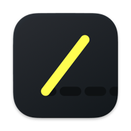</p>

<h1 align="center">Gnomon</h1>

<p align="center"><b>A calm work-hour tracker for your Mac.</b><br>
Clock in and out, track your projects, catch up later, and always know your overtime balance.</p>

<p align="center">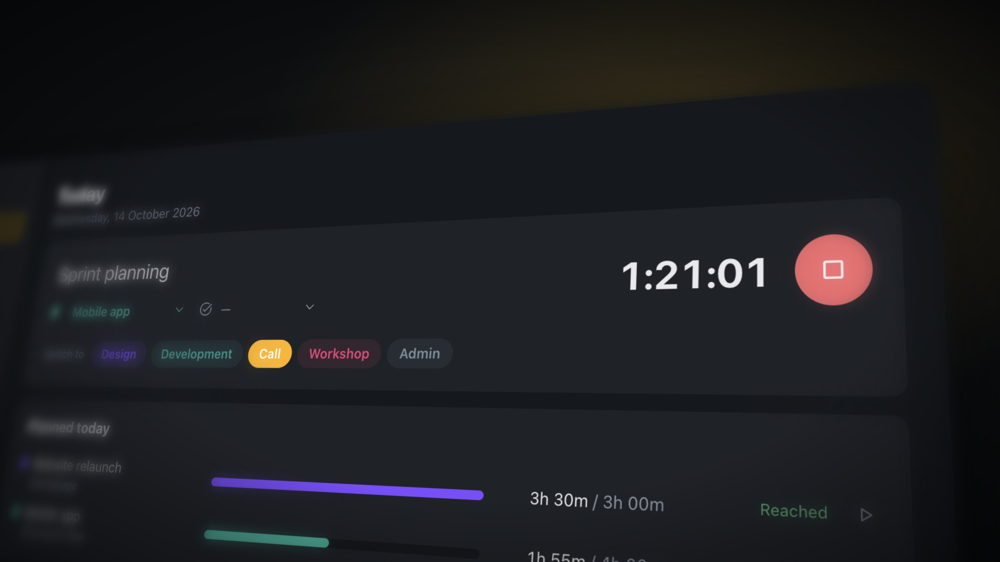</p>

*A gnomon is the pointer on a sundial, the oldest time-tracking tool there is.*

<p align="center"><b><a href="https://github.com/DennHa/gnomon/releases/latest">⬇ Download the latest version</a></b> · <a href="CHANGELOG.md">What's new</a></p>

## What it does

### 1. Clock in, clock out

Your workday in two clicks. Press **Start day** when you sit down, take a **Break**, and **Leave** when you're done:
from the sidebar, the menu bar or a keyboard shortcut. Forgot to clock out? Gnomon closes the day at midnight and asks
the next morning when you actually left.

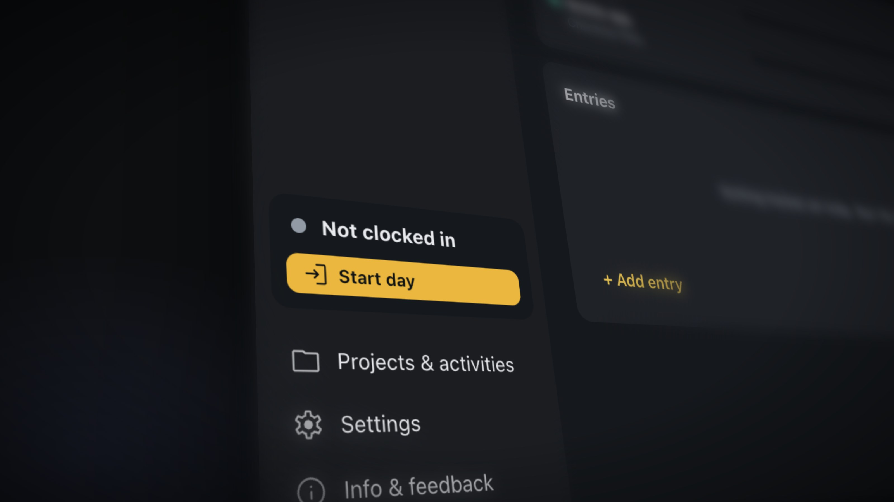

### 2. Track the projects you're on

Your plan from **Float** becomes today's list: start a timer on a planned project with one click, or press **⌃⌥P** in
any app and type a few letters. Switch the activity (Design, Call, Workshop…) without stopping the clock, and see how far
each project is against its plan. Weblog support follows once its API is available.

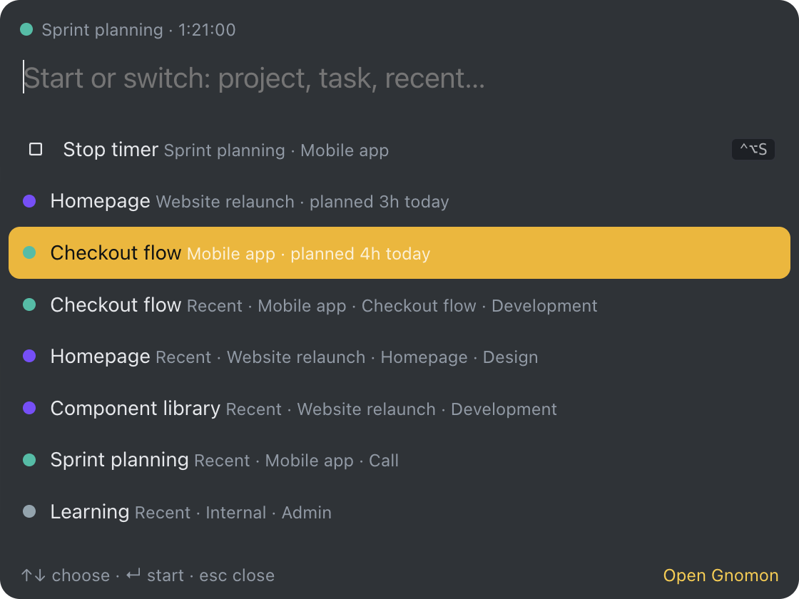

### 3. Catch up later

Not a live tracker? No problem. Fill in a whole week afterwards: type hours straight into the timesheet, **repeat**
yesterday, **copy last week**, or **fill from plan** to turn your Float plan into entries. Each day shows what's still
open against your plan.

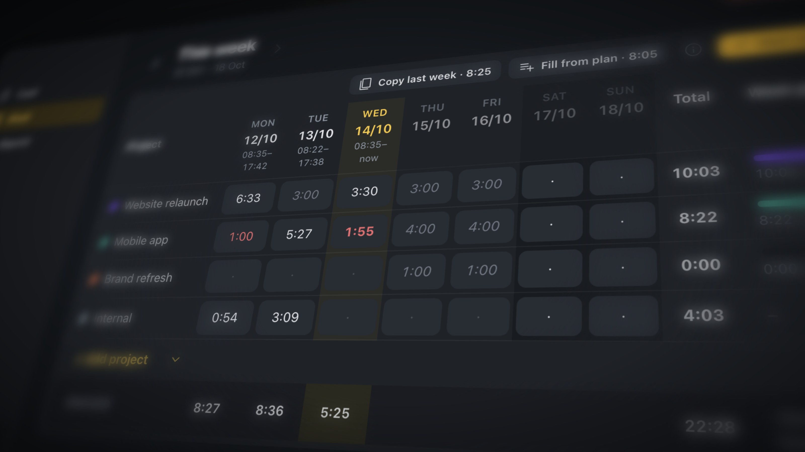

### 4. Always know your balance

Gnomon counts every workday against your daily target and keeps a running **overtime balance**, month by month.
Vacation and sick days from **Personio** don't count against you; *overtime off* days use the balance. One number tells
you where you stand.

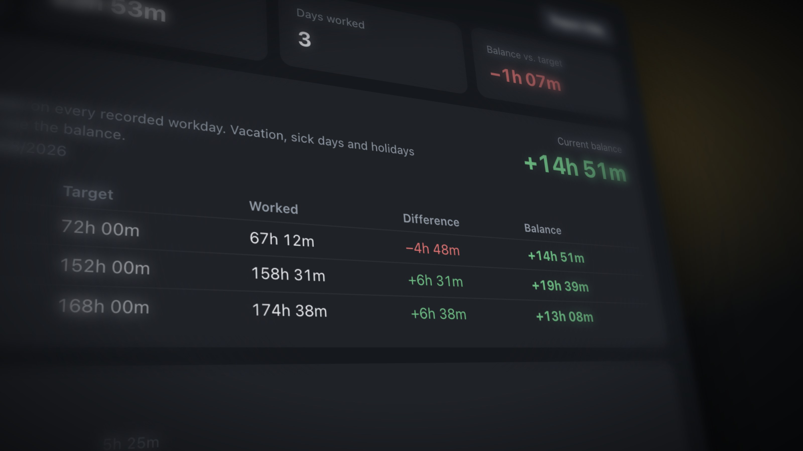

### On your phone too

A small web app on your own server (see [server/README.md](server/README.md)): clock in on the way in, correct today's
times, start or switch a timer, and check your week. Pair a phone by scanning a QR code from the Mac app.

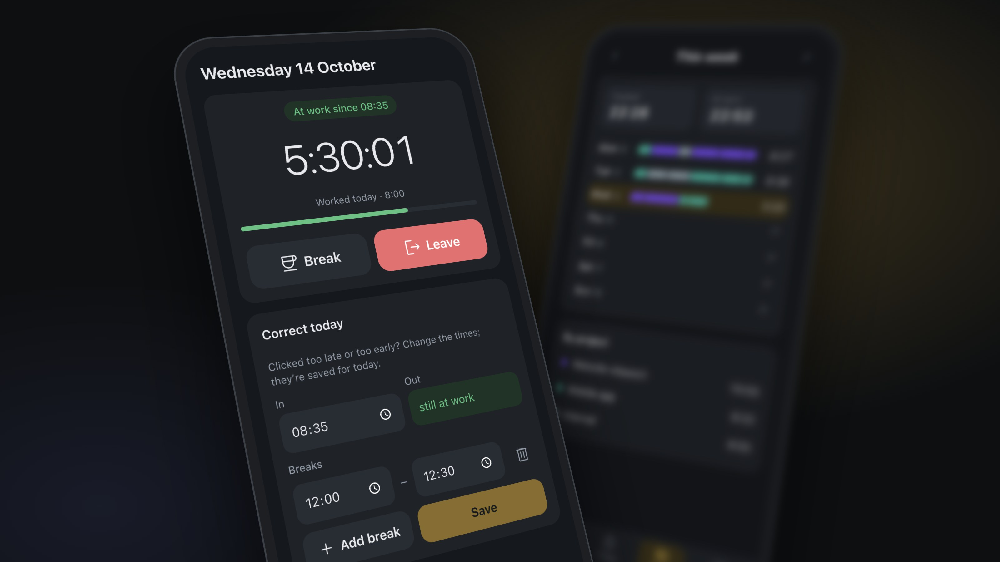

## Screenshots

| | |
|---|---|
| 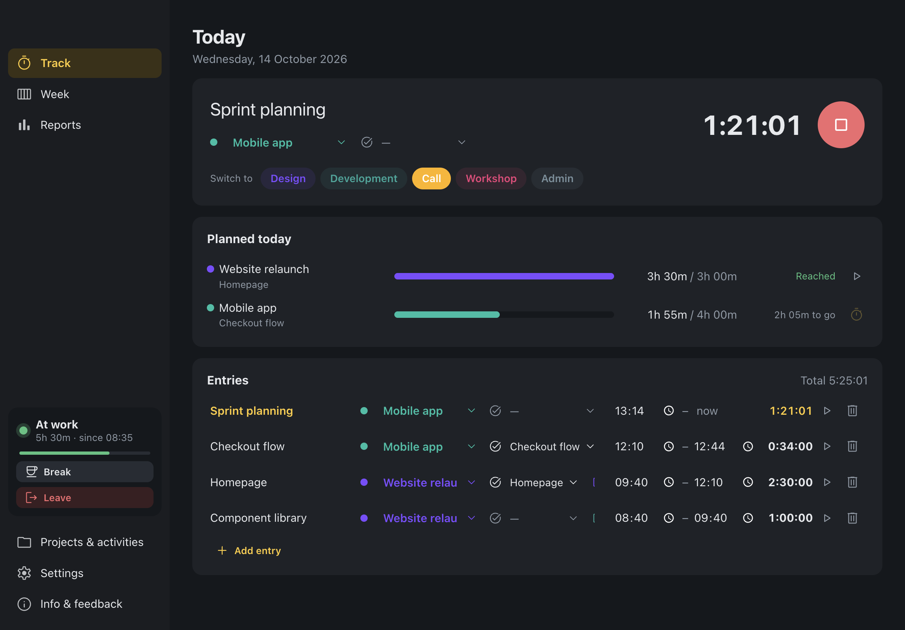 | 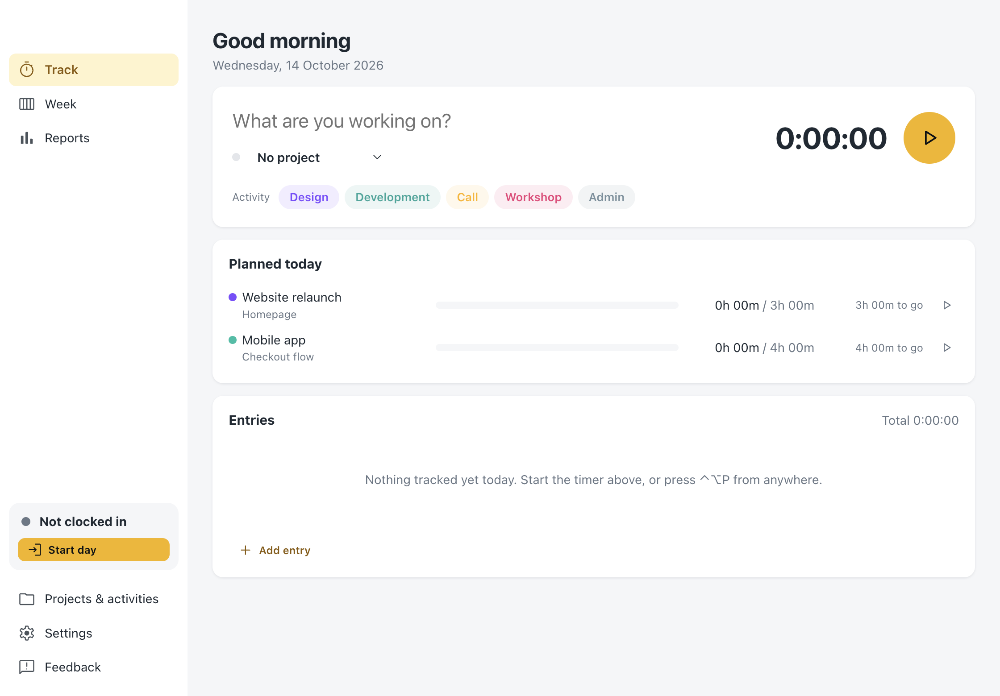 |
| 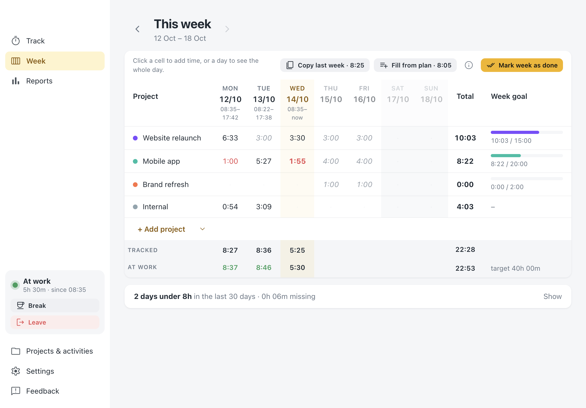 | 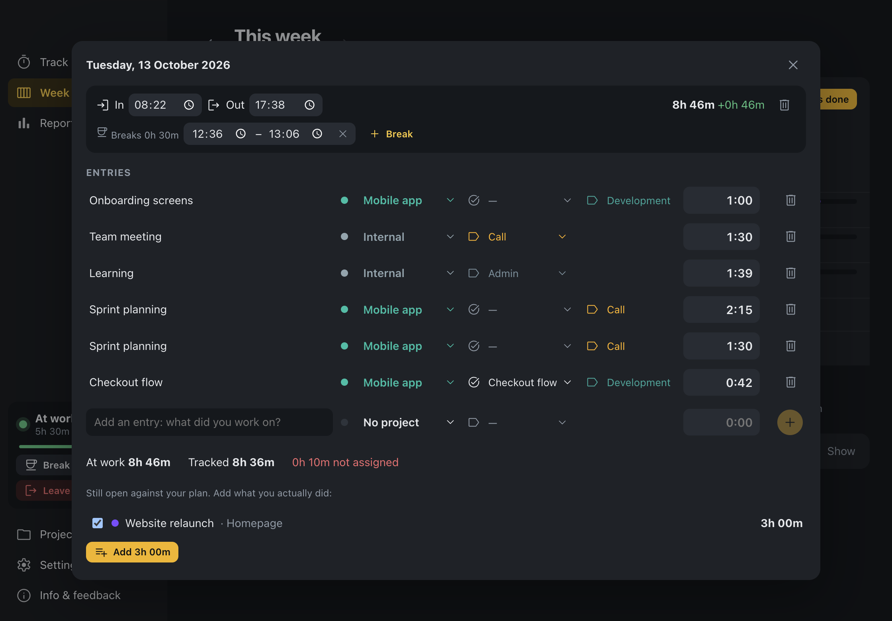 |
| 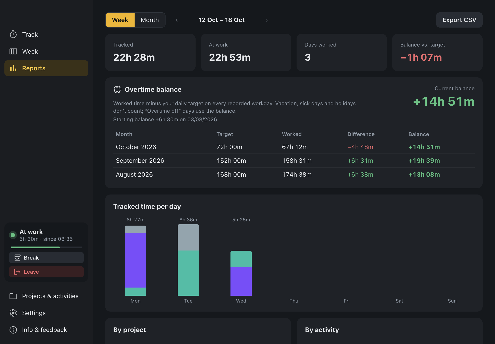 |  |

<p>
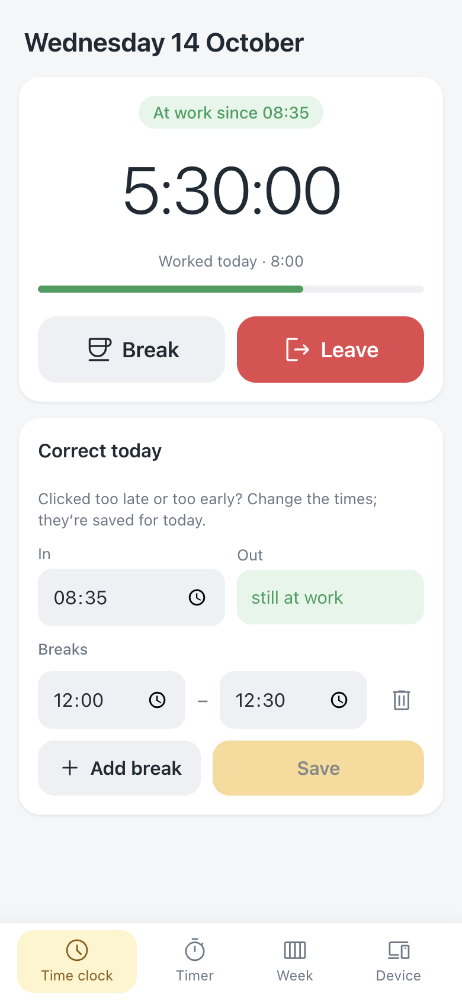
&nbsp;
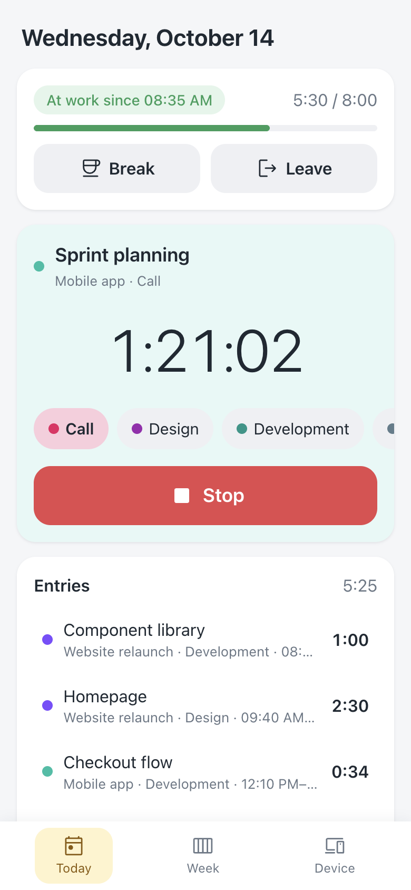
&nbsp;
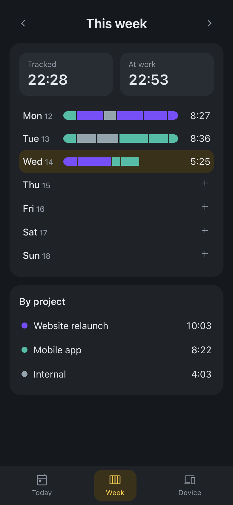
</p>

<sub>All pictures use made-up demo data (`scripts/demo-data.cjs`). Retake them with `sh scripts/screenshots.sh` and
`node node_modules/electron/cli.js scripts/phone-screenshots.cjs`, then render the close-ups with
`node node_modules/electron/cli.js scripts/hero-shots.cjs`.</sub>

## For companies (planned)

Float and Personio only issue company-wide admin tokens, so employees can't connect them themselves, and those
tokens shouldn't sit on every Mac. The plan: the company runs the Gnomon server, which holds the tokens and hands
each person only their own plan and absences. People sign in with their Microsoft company account (Entra ID), and
Iru (Mac management) installs Gnomon with the server address preconfigured. In that managed mode the setup guide
and token fields are hidden. An admin sets everything up once in a guided web wizard on the server, which also
produces the Iru settings profile. Details and what's still to build: [docs/company-setup.md](docs/company-setup.md).

## All features

A macOS desktop app (Electron + React + TypeScript) for:

- **Clocking in and out**: *Start day* in the morning, *Break*, and *Leave* in the evening. These controls are always in the sidebar and in the menu bar. If you forgot to clock out yesterday, the app asks when you left.
- **Projects and activities**: a project is *who* the work is for (Client XYZ); an activity is *what kind* of work it is (Call, Design, Presentation). While a timer runs, clicking an activity chip switches to it and keeps the project. Entries can be marked billable (€).
- **Day view**: ‹ › or a date picker to go back in time, and *Jump to today*. Past days are fully editable (in/out, breaks, entries); you can add a forgotten workday or mark a day off. A list shows the days that ended below your daily target.
- **Week view**: a timesheet with one row per project and one column per day, plus planned hours and week goals.
- **Float import** (Settings → Float): your allocations become the daily plan per project (task, from–to, hours per day, time window), Float projects land in Projects, and time off and public holidays become days off. Read-only; it syncs once a day in the morning or via *Sync now*. The API token (Float → Account Settings → Integrations, owner/admin only) is stored encrypted in the keychain.
- **Personio import** (Settings → Personio): approved vacation, sick days and other absences become days off, so the overtime balance stays right. Read-only (API v2); a Personio admin creates API credentials (client ID + secret) with read access to absences and employees. Syncs once a day in the morning or via *Sync now*; half days are not imported (enter them yourself). Credentials are stored encrypted in the keychain.
- **First-launch tour**: on first start a short tour explains the key features (clock in/out, tracking projects, catching up later, the overtime balance); reopen it from Settings → General. Connecting Float, Personio and Weblog is a separate step-by-step guide, offered at the end of the tour and in Settings → Connections (Weblog is a placeholder until its API is available).
- **Menu bar**: start day / break / leave, *Start project*, *Switch activity*, *Continue recent*.
- **Reports**: week or month view, tracked time per day stacked by project, breakdowns by project and by activity, billable hours, an attendance table, balance against your daily target, and CSV export.
- **Settings**: daily target, auto clock-in (when the app opens, or when you start a timer), and whether to show the running time in the menu bar.

Everything stays on your Mac, in `~/Library/Application Support/Gnomon/data.json`.

## Versions and updates

- **Download:** the newest `.dmg` is on the [Releases page](https://github.com/DennHa/gnomon/releases/latest);
  [CHANGELOG.md](CHANGELOG.md) lists what changed. The app shows both under **Info & feedback**.
- **Update check:** Gnomon reads a small `version.json` from your Gnomon server (`/latest/version.json`), or from the
  address a company profile sets. A server can also host the download page itself: see
  [server/README.md](server/README.md#download-page-for-the-mac-app-optional). Nothing is tied to GitHub or one host.
- **Making a release:** bump `version` in `package.json`, add a section to `CHANGELOG.md`, then
  `npm run dist && npm run release:manifest`, and upload the `.dmg` (and `version.json` for a server).

## Run

```bash
npm install
npm run dev     # Vite + Electron with hot reload
npm start       # production build, then launch
npm run dist    # build Gnomon.app and a .dmg into release/
npm run icon    # app, phone and menu bar icons from build/*.svg
sh scripts/screenshots.sh   # README screenshots (after npm run build)
```

## Installing the app

`npm run dist` creates `release/Gnomon-<version>-arm64.dmg`. Open it, drag **Gnomon** into **Applications**, and start it from there.
To have it ready every morning, add it under System Settings → General → Login Items.

The app is ad-hoc signed (see `scripts/adhoc-sign.cjs`), not signed with an Apple Developer ID. That's fine on the Mac
that built it. If you copy the .dmg to another Mac, the first launch needs right-click → **Open** (or System Settings →
Privacy & Security → *Open Anyway*). Signing for distribution requires a paid Apple Developer account.

Updating: build a new .dmg and drag the new Gnomon over the old one. Your data stays in
`~/Library/Application Support/Gnomon/` and isn't touched.

## Where it lives

Keep the project outside synced folders such as Nextcloud: Nextcloud strips the execute
permission from files in `node_modules` (e.g. esbuild), which breaks builds with `EACCES`.
Back it up with git instead of the sync folder.

## Where your data lives

Everything stays on your Mac, in `~/Library/Application Support/Gnomon/` (folder and files readable only by your user):

| File | What | Notes |
|---|---|---|
| `data.json` | Entries, workdays, projects, activities, settings, imported Float plan | Plain JSON, written atomically. Back it up or copy it to another Mac. |
| `float-token.json` | Float API token | Encrypted with a key held in the macOS keychain (Electron `safeStorage`); never sent to the window. |
| `personio-credentials.json` | Personio client ID + secret | Encrypted the same way; never sent to the window. |
| `trail.json` | Activity trail (only if enabled) |
| `api-key.json` | Local API key (encrypted, only if created) | App names and times only, never window titles; about two months are kept. "Delete trail" in Settings removes it. |

Nothing is sent anywhere except to `api.float.com` and `api.personio.de`, and only after you connect them (read-only requests; Personio additionally gets one token request with your client credentials).
There's no analytics, tracking or auto-update.

## Security notes

- Windows run sandboxed with context isolation and no Node.js access; the page talks to the system only through a small preload API.
- The production build has a strict Content-Security-Policy (no remote scripts), and windows can't navigate away or open new windows.
- Float and Personio requests go through the main process with a fixed base URL and read-only endpoints, so the page never sees the token or credentials.
- To test against mocks: `FLOAT_API_BASE=…` and `PERSONIO_API_BASE=http://127.0.0.1:7811` (run `node tests/personio-mock.cjs`; client ID `demo-id`, secret `demo-secret`, email `alex@example.com`).
- The activity trail reads the frontmost app's name with `lsappinfo` (no shell, fixed arguments, no extra permissions).
- Keep Electron current: `npm audit` lists build-tool advisories (electron-builder, vite's dev server) that don't ship in the app.

Run the logic tests with `npm test`.

See also [API.md](API.md) (local REST API) and [FINDINGS.md](FINDINGS.md) (decisions, psychology, security, next steps).
