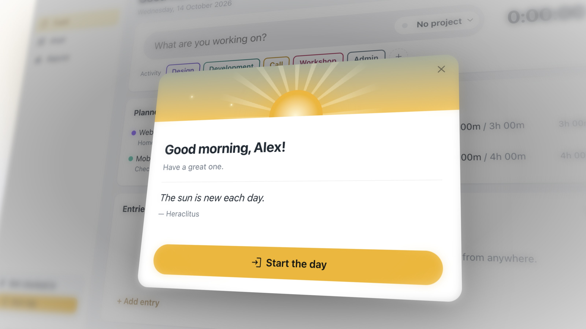

<p align="center"></p>

<h1 align="center">Know where your day went.</h1>

<p align="center"><b>Gnomon</b> keeps your work hours, your projects and your overtime in one calm app for your Mac and your
phone. It fits the way you work, and once it's set up, it stays out of your way.</p>

<p align="center"></p>

<p align="center"><b><a href="https://github.com/DennHa/gnomon/releases/latest">⬇ Download for Mac</a></b> · <a href="CHANGELOG.md">What's new</a></p>

| **Easy** | **Your way** | **Set and forget** | **Every device** |
|---|---|---|---|
| One click starts the day. A few letters start a timer, from any app. | Clock in and fill in later, or time every task live. Switch whenever you like. | It lives in the menu bar and only speaks up when something is missing. | Mac and phone, in sync. In the browser soon, too. |

## Fits the way you already work

Some people clock in and sort out the hours at the end of the day or the week. Others time every task as it happens.
Gnomon is good at both, asks on the first start which one sounds like you, and lets you switch any time.

- **Clock in, fill in later:** *Start day*, *Break*, *Leave*, then put the hours on projects in the **Week**, a timesheet
  that shows what's still unassigned. Copy last week or fill it from your plan in one click.
- **Track live:** start a timer, switch project or activity with a click, no stopping in between. The first timer
  clocks you in.

Either way, project time always fits the hours you were actually at work.


## Two seconds, from any app

Press **⌃⌥P** wherever you are, type a few letters of the project, press Enter: the timer runs. Switch to a call or a
workshop without stopping the clock. With **Float** connected, today's planned projects are one click away.


## Set it up once. Then forget it's there

Gnomon sits quietly in the menu bar. Forgot to clock out? It closes the day at midnight and suggests when you really
left. Added an entry outside your hours? Your workday adjusts. It only reminds you when something is actually missing.


## Always know where you stand

Every workday counts against your own schedule: part time, a free Friday, a change from July on. Vacation and sick days
(from **Personio**, or marked by hand) don't count against you. Start from the balance your company shows, and Gnomon
carries it on, month by month.


## On your Mac, on your phone

Clock in on the way to work, correct a time on the train, start a timer from the couch. The phone app runs on your own
Gnomon server and stays in sync with your Mac; pair it by scanning a QR code ([server/README.md](server/README.md)).

**Mac** ✓ · **Phone** ✓ · **Web** coming soon


<details>
<summary><b>And a little extra:</b> a good start to every day</summary>
<br>
The first time you open Gnomon on a workday, a short sunrise greets you, with one click to get going.
<br><br>

</details>

## Private by default

- **Your data stays with you.** Everything lives on your Mac in `~/Library/Application Support/Gnomon/`, readable
  only by your user. No account, no cloud, no analytics.
- **Secrets in the keychain.** Tokens and keys are encrypted by macOS. Gnomon only talks to services you connect
  yourself, and only checks for updates on your own server.
- **Works with what you use**, all optional: **Float** (your plan, read-only), **Personio** (your absences, read-only),
  **CSV export** of any week or month, and a local REST API for your own tools ([API.md](API.md)).

## Get started

1. Download the latest **Gnomon-…-arm64.dmg** from [Releases](https://github.com/DennHa/gnomon/releases/latest)
   (Apple silicon Macs).
2. Open it and drag **Gnomon** into **Applications**.
3. First start: **right-click Gnomon → Open**, then confirm. The app isn't signed with an Apple Developer ID yet, so
   macOS asks once.
4. A short intro asks how you like to work; connect Float or Personio afterwards under Settings → Connections.

To have it ready every morning, add Gnomon under System Settings → General → Login Items. Updating: drag the new version
over the old one; your data stays where it is.

## For teams

A company runs its own Gnomon server: one command installs it on any Linux machine with Docker, and a setup page walks
through the admin account, HTTPS, email, who may register, the Mac app download and nightly encrypted backups, then
invites people. Everyone signs in with their email on the Mac, the phone and the web, and sees only their own times.
The server can also hold the Float and Personio admin tokens and give each person only their own plan and absences,
and IT can roll out Gnomon preconfigured with a Mac management tool. For admins: the
[admin guide](docs/admin-guide.md). The plan behind it: [docs/company-setup.md](docs/company-setup.md).

<p align="center"><sub>A <i>gnomon</i> is the pointer on a sundial: the oldest time tracker there is. All pictures use made-up data.</sub></p>

---

## For developers

A macOS app built with Electron, React and TypeScript; the optional server is Node with SQLite.

```bash
npm install
npm run dev     # Vite + Electron with hot reload
npm start       # production build, then launch
npm test        # logic tests
npm run dist    # Gnomon.app and a .dmg in release/
```

Keep the project outside synced folders such as Nextcloud, which strip the execute permission from files in
`node_modules` and break the build.

**Releases.** Bump `version` in `package.json` and add a section to `CHANGELOG.md`, then
`npm run dist && npm run release:manifest` and upload the `.dmg`. A Gnomon server can host the download and the
`version.json` the app's update check reads (see
[server/README.md](server/README.md#download-page-for-the-mac-app)).

**Site and demo.** `site/` is a one-page site (static files, no build step); `npm run build:demo` builds the web demo
into `dist-demo/`. A Gnomon server serves them at `/about` and `/example` (see
[server/README.md](server/README.md#one-page-site-and-web-demo-optional)).

**Pictures.** `sh scripts/screenshots.sh` and `node node_modules/electron/cli.js scripts/phone-screenshots.cjs` retake
the screenshots with demo data (`scripts/demo-data.cjs`); `scripts/hero-shots.cjs` renders the close-ups; `npm run icon`
renders the icons from `build/*.svg`.

**Data files** in `~/Library/Application Support/Gnomon/`:

| File | What |
|---|---|
| `data.json` | Entries, workdays, projects, activities, settings, imported plan. Plain JSON, written atomically. |
| `float-token.json`, `personio-credentials.json`, `api-key.json`, `server.json` | Secrets, encrypted with a key in the macOS keychain (Electron `safeStorage`); never sent to the window. |
| `server-sync.json` | Sync state with your Gnomon server. |
| `trail.json` | Activity trail, only if switched on: app names and times, never window titles. |

**Security.** Windows are sandboxed with context isolation and no Node.js access; the page reaches the system only
through a small preload API. The build has a strict Content-Security-Policy, and windows can't navigate away. Float and
Personio calls go through the main process with fixed base URLs and read-only endpoints. To test against mocks, set
`FLOAT_API_BASE` or `PERSONIO_API_BASE` (`node tests/personio-mock.cjs`).

More: [API.md](API.md) (local REST API), [server/README.md](server/README.md) (server and phone app),
[docs/company-setup.md](docs/company-setup.md) (company setup), [FINDINGS.md](FINDINGS.md) (decisions and notes).
