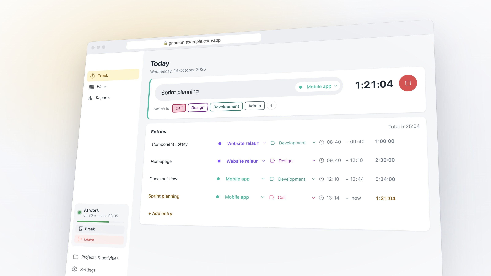

<p align="center"></p>

<h1 align="center">Know where your day went.</h1>

<p align="center"><b>Gnomon</b> keeps your work hours, your projects and your overtime in one calm app for your Mac, your
phone and your browser. Use it on your own, or run it for your whole company on your own server. It fits the way you
work, and once it's set up, it stays out of your way.</p>

<p align="center"></p>

<p align="center"><b><a href="https://github.com/DennHa/gnomon/releases/latest">⬇ Download for Mac</a></b> · <a href="#for-your-company-install-in-one-command">For your company</a> · <a href="docs/ROADMAP.md">Roadmap</a> · <a href="CHANGELOG.md">What's new</a></p>

| **Easy** | **Your way** | **Set and forget** | **Every device** |
|---|---|---|---|
| One click starts the day. A few letters start a timer, from any app. | Clock in and fill in later, or time every task live. Switch whenever you like. | It lives in the menu bar and only speaks up when something is missing. | Mac, phone and browser, in sync. |

## Why Gnomon

- **Work hours and bookings, kept apart.** When you clocked in and out is one thing; which projects you booked is
  another. Gnomon never moves one to fit the other, and only tells you the difference.
- **Overtime on your own schedule.** Part time, a free Friday, a change from July on, and the starting balance your
  company gives you.
- **Float and Personio built in.** Fill the week from your plan in one click; vacation and sick days don't count
  against you.
- **Private by design.** On your Mac, or on your company's own server. Admins manage accounts, never anyone's times.
  No screenshots, no tracking of what you do.
- **Free.** No tiers, no features moving behind a price later.

## Fits the way you already work

Some people clock in and sort out the hours at the end of the day or the week. Others time every task as it happens.
Gnomon is good at both, asks on the first start which one sounds like you, and lets you switch any time.

- **Clock in, fill in later:** *Start day*, *Break*, *Leave*, then put the hours on projects in the **Week**, a timesheet
  that shows what's still unassigned. Copy last week or fill it from your plan in one click.
- **Track live:** start a timer, switch project or activity with a click, no stopping in between. The first timer
  clocks you in.


## Two seconds, from any app

Press **⌃⌥P** wherever you are, type a few letters of the project, press Enter: the timer runs. Switch to a call or a
workshop without stopping the clock. With **Float** connected, today's planned projects are one click away.


## Set it up once. Then forget it's there

Gnomon sits quietly in the menu bar. Forgot to clock out? It closes the day at midnight and suggests when you really
left. Didn't clock in at all? The day follows your bookings. It only reminds you when something is actually missing.


## Always know where you stand

Every workday counts against your own schedule. Vacation and sick days (from **Personio**, or marked by hand) don't
count against you. Your hours at work and your project bookings stay separate, so the balance is about when you
worked, not how you filled in the week. Start from the balance your company shows, and Gnomon carries it on, month by
month.


## On your Mac, your phone, your browser

Clock in on the way to work, correct a time on the train, fill in the week from any laptop. With an account on a
Gnomon server, you sign in with your email and password everywhere, and your daily target, schedule and balance
follow your account.

**Mac** ✓ · **Phone** ✓ · **Web** ✓




The phone app is a web app you add to your home screen, and the browser has Track, Week, Reports and Projects. The
menu bar, the quick switcher, Float and Personio stay on the Mac.

<details>
<summary><b>And a little extra:</b> a good start to every day</summary>
<br>
The first time you open Gnomon on a workday, a short sunrise greets you, with one click to get going.
<br><br>

</details>

## Private by default

- **Your data stays with you.** On your own, everything lives on your Mac in `~/Library/Application Support/Gnomon/`,
  readable only by your user: no account, no cloud, no analytics. With a company server, it lives on that server and
  nowhere else. There is no Gnomon cloud.
- **Only your own times.** Everyone sees only their own entries. Admins invite people and manage accounts, but never
  see anyone's times.
- **Secrets in the keychain.** Tokens and keys are encrypted by macOS. Gnomon only talks to services you connect
  yourself.
- **Works with what you use**, all optional: **Float** (your plan, read-only), **Personio** (your absences, read-only),
  **CSV export** of any week or month, and a local REST API for your own tools ([API.md](API.md)).

## Get started on your own

1. Download the latest **Gnomon-…-arm64.dmg** from [Releases](https://github.com/DennHa/gnomon/releases/latest).
   It runs on **Apple silicon Macs** (M1 and newer) only.
2. Open it and drag **Gnomon** into **Applications**.
3. First start: **right-click Gnomon → Open**, then confirm. The app isn't signed with an Apple Developer ID yet, so
   macOS asks once.
4. Choose *On this Mac only*, or sign in to your company's Gnomon server. A short intro asks how you like to work;
   connect Float or Personio afterwards under Settings → Connections.

To have it ready every morning, add Gnomon under System Settings → General → Login Items. Updating: drag the new version
over the old one; your data stays where it is.

## For your company: install in one command

A company runs its own Gnomon server, on any Linux machine with Docker (a VM, a small cloud server, even a Raspberry
Pi). One command installs it:

```bash
curl -fsSL https://raw.githubusercontent.com/DennHa/gnomon/main/server/deploy/install.sh -o install.sh
sudo sh install.sh
```

- **HTTPS your way:** an automatic certificate, your own certificate, behind your reverse proxy, or a Cloudflare
  Tunnel. It uses a ready-made image (`ghcr.io/dennha/gnomon-server`), or builds from the code if your policy says so.
- **A setup page in the browser** walks through your admin account, the server's address, email (SMTP or
  Microsoft 365), who may register, where the Mac app comes from, backups, and inviting people.
- **Accounts for everyone:** invite one person or a whole list (CSV or pasted), by email or as links. People sign in
  with email and password on the Mac, the phone and the web, and reset a forgotten password themselves.
- **Nightly encrypted backups**, on by default, and **`gnomon-admin`** for status, updates (with a backup first),
  restore and logs.
- **Optional:** IT rolls out the Mac app already connected to the server, with a Mac management tool such as Iru.

Everything for IT, from the install to security and troubleshooting: the **[admin guide](docs/admin-guide.md)**.
Not there yet: signing in with your company login (Microsoft, Google, Okta); Float and Personio handed out per person
by the server (today each person connects them on their Mac); and a Mac app signed by Apple (until then, use your own
signed build for a roll-out).

## What's next

The [roadmap](docs/ROADMAP.md) shows what's being built, what's next and what's left out on purpose (no invoicing, no
screenshots or activity scores). A Gnomon server shows it at `/roadmap`.

<p align="center"><sub>A <i>gnomon</i> is the pointer on a sundial: the oldest time tracker there is. All pictures use made-up data.</sub></p>

---

## For developers

A macOS app built with Electron, React and TypeScript; the optional server is Node with SQLite and serves the phone app,
the web app (`/app`), the account and admin pages.

```bash
npm install
npm run dev     # Vite + Electron with hot reload
npm start       # production build, then launch
npm test        # logic tests
npm run test:instances  # one Gnomon per data folder, with real app starts on scratch folders
npm run dist    # Gnomon.app and a .dmg in release/
```

**Never start a test copy on the real data folder.** Always give it a scratch one, e.g.
`USER_DATA_DIR=$(mktemp -d) npm start`. Only one Gnomon runs per data folder; a second start on the same folder quits.

Keep the project outside synced folders such as Nextcloud, which strip the execute permission from files in
`node_modules` and break the build.

**Server.** `cd server && npm install && npm run build && npm test`; how it works, its API and running it locally are
in [server/README.md](server/README.md). Installing it for real is in the [admin guide](docs/admin-guide.md).

**Releases.** Bump `version` in `package.json` and add a section to `CHANGELOG.md`, then
`npm run dist && npm run release:manifest` and upload the `.dmg`. Pushing a `v*` tag publishes the server image. A
Gnomon server can host the download and the `version.json` the app's update check reads (see
[server/README.md](server/README.md#download-page-for-the-mac-app)).

**Site, roadmap and demo.** `site/` is a one-page site (static files, no build step), the roadmap page is built from
[docs/ROADMAP.md](docs/ROADMAP.md), and `npm run build:demo` builds the web demo into `dist-demo/`. A Gnomon server
serves them at `/about`, `/roadmap` and `/example` (see
[server/README.md](server/README.md#one-page-site-and-web-demo-optional)).

**Pictures.** `sh scripts/screenshots.sh` and `node node_modules/electron/cli.js scripts/phone-screenshots.cjs` (phone
and web app) retake the screenshots with demo data (`scripts/demo-data.cjs`); `scripts/hero-shots.cjs` renders the
close-ups; `npm run icon` renders the icons from `build/*.svg`.

**Data files** in `~/Library/Application Support/Gnomon/`:

| File | What |
|---|---|
| `data.json` | Entries, workdays, projects, activities, settings, imported plan. Plain JSON, written atomically. |
| `float-token.json`, `personio-credentials.json`, `api-key.json`, `server.json` | Secrets, encrypted with a key in the macOS keychain (Electron `safeStorage`); never sent to the window. |
| `server-sync.json` | Sync state with your Gnomon server. |
| `gnomon.lock` | Which process has the folder open, so a second Gnomon stays off it. Removed on quit. |
| `trail.json` | Activity trail, only if switched on: app names and times, never window titles. |

**Security.** Windows are sandboxed with context isolation and no Node.js access; the page reaches the system only
through a small preload API. The build has a strict Content-Security-Policy, and windows can't navigate away. Float and
Personio calls go through the main process with fixed base URLs and read-only endpoints. To test against mocks, set
`FLOAT_API_BASE` or `PERSONIO_API_BASE` (`node tests/personio-mock.cjs`). The server's side is in the admin guide's
[security section](docs/admin-guide.md#security-and-privacy).

More: [API.md](API.md) (local REST API), [server/README.md](server/README.md) (server, phone and web app),
[docs/admin-guide.md](docs/admin-guide.md) (running a server), [docs/company-setup.md](docs/company-setup.md) (company
setup plan), [FINDINGS.md](FINDINGS.md) (decisions and notes).
